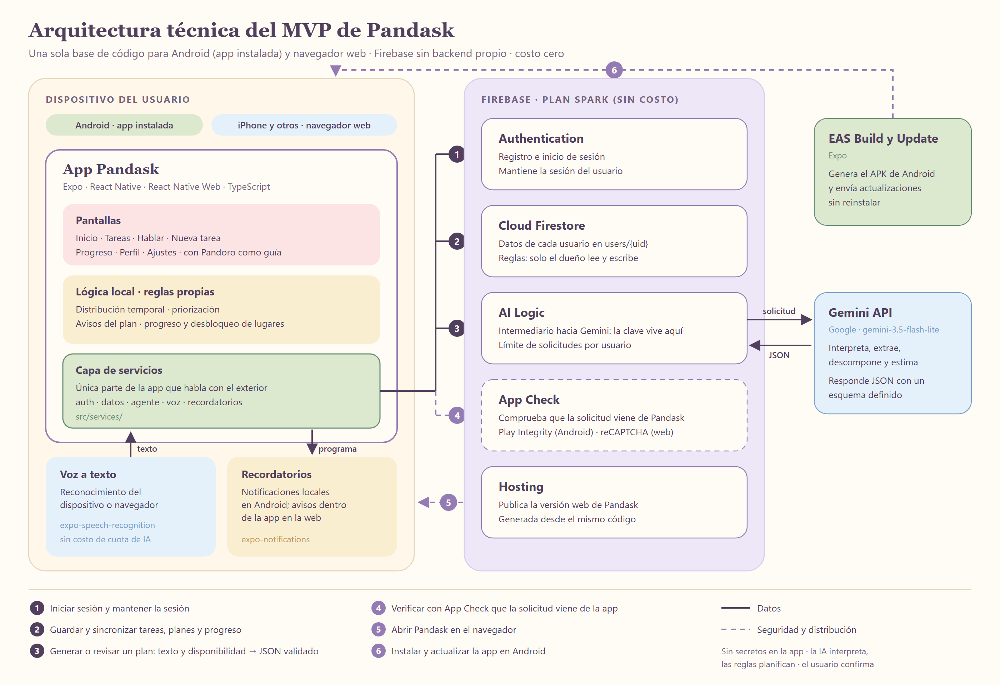
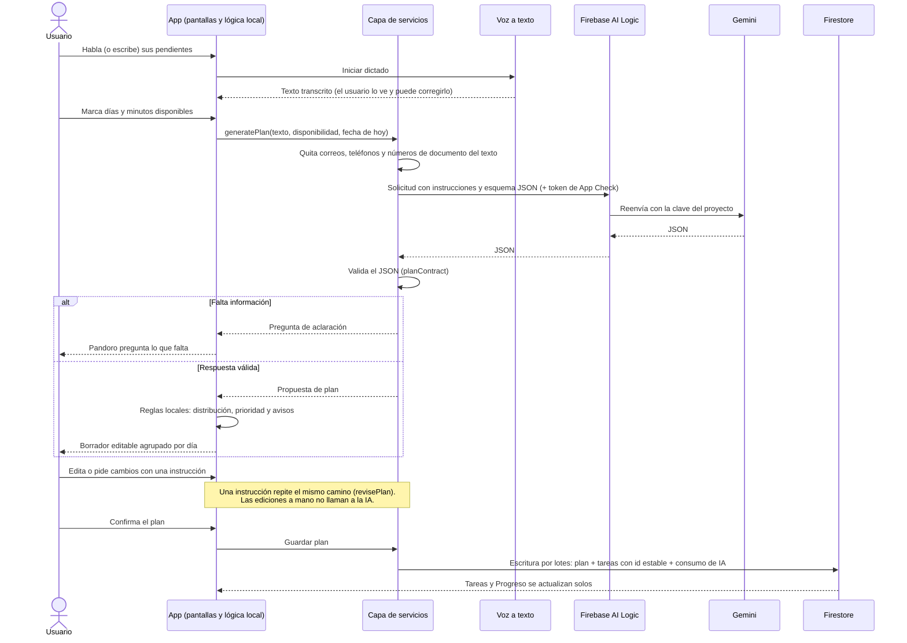

# Arquitectura técnica del MVP de Pandask

| | |
| --- | --- |
| **Tarea** | Fila 9 del cronograma: definir la arquitectura técnica del MVP |
| **Responsable** | Carlos Sánchez |
| **Estado** | Propuesta para revisión del equipo (2 de noviembre de 2026) |
| **Se apoya en** | [`docs/CONTEXTO.md`](CONTEXTO.md): alcance F01–F15, restricciones y decisiones registradas |

Este documento explica qué piezas tiene Pandask, qué hace cada una y cómo viaja la información entre ellas. Es la referencia para las tareas de desarrollo, QA y despliegue (filas 15 a 33). Los campos de cada entidad no están aquí: son del modelo de datos (fila 10, Andrea). Las reglas detalladas de seguridad son de la fila 14 (Esteban). Donde la arquitectura depende de esas tareas, lo dice en [Por confirmar](#9-por-confirmar).



Versión vectorial para el informe: [`arquitectura/diagrama-arquitectura.svg`](arquitectura/diagrama-arquitectura.svg).

## 1. Resumen

Pandask es **una sola base de código** (Expo + React Native + React Native Web) que se usa de dos formas: como **app instalada en Android** y como **página web** para iPhone y cualquier otro dispositivo. No hay backend propio: **Firebase** pone la autenticación, la base de datos, la conexión con la IA y el alojamiento web, todo en el plan gratuito **Spark**. La IA es **Gemini**, y la app la llama a través de **Firebase AI Logic**, así que la clave de Gemini nunca está dentro de la app.

Dentro de la app, las pantallas no hablan directamente con Firebase ni con Gemini. Todo pasa por una **capa de servicios** (`src/services/`), que es la única parte que conoce a los proveedores externos. Así, cambiar de proveedor o de plataforma solo toca esa capa.

## 2. Principios

Estas reglas guían todas las decisiones de abajo. Si una tarea nueva choca con alguna, se discute antes de implementarla.

1. **Costo cero.** Solo el plan Spark de Firebase y las cuotas gratuitas de Gemini y de Expo. Nada que obligue a vincular una cuenta de facturación (eso pasaría el proyecto al plan Blaze). En Spark, cuando se agota una cuota, el servicio deja de responder hasta que se reinicia; nunca genera cobros.
2. **Sin backend propio** (decisión de Santiago). Firebase cumple ese papel.
3. **Ningún secreto dentro de la app.** Todo lo que viaja en el paquete de la app se puede extraer. La configuración de Firebase es pública por diseño. La protección viene de las reglas de seguridad de Firestore y de App Check, no de esconder valores.
4. **La IA interpreta; las reglas planifican.** Gemini solo interpreta, extrae, descompone y estima. La distribución en el calendario, la priorización y los avisos los calculan reglas propias en la app: son reproducibles, se pueden probar y no gastan cuota.
5. **El usuario confirma.** Nada que proponga la IA se guarda sin que el usuario lo revise y lo apruebe (F08).
6. **Una sola puerta hacia afuera.** Solo la capa de servicios importa SDKs de Firebase, Gemini, voz o notificaciones. Pantallas, proveedores de estado y lógica local dependen de interfaces propias.
7. **Lo manual nunca depende de la IA.** Si Gemini falla, se agota la cuota o el usuario no autoriza el asistente, puede seguir creando, editando y completando tareas a mano.
8. **Privacidad desde el diseño.** Solo se recoge, se envía y se guarda lo necesario, como exigen la Ley 1581 de 2012 y la Circular SIC 002 de 2024 (ver [Marco normativo](CONTEXTO.md#marco-normativo)). Lo que propone la IA siempre es una "sugerencia de Pandoro" que el usuario confirma.

## 3. Plataformas y distribución

| Dispositivo | Cómo se usa Pandask | Cómo llega al usuario |
| --- | --- | --- |
| Android | App instalada | APK generado con EAS Build (distribución interna, sin Play Store). Los cambios posteriores llegan con EAS Update, sin reinstalar. |
| iPhone y cualquier otro | Navegador web | Versión web generada desde el mismo código y publicada en Firebase Hosting. |
| Equipo de desarrollo | Development build en Android | Cada integrante instala una app de desarrollo propia (`expo-dev-client`) en lugar de Expo Go. Se trabaja igual que ahora (`npm start`); solo se recompila al agregar una librería nativa. |

**Por qué no Expo Go:** la voz y el SDK nativo de Firebase usan código nativo que Expo Go no incluye.

**Por qué no hay app de iPhone en el MVP:** Apple solo permite instalar apps fuera de la App Store (TestFlight o distribución ad hoc) con una cuenta de Apple Developer pagada (99 USD al año), lo que rompe la restricción de costo cero. Si el equipo la paga más adelante, la app de iPhone sale del mismo código sin cambiar esta arquitectura.

## 4. Componentes

| Componente | Tecnología | Qué hace | Funcionalidades |
| --- | --- | --- | --- |
| Pantallas | Expo Router, `src/screens/`, `src/components/` | Lo que ve el usuario, con Pandoro como guía. | F11, F13 |
| Estado de la app | Providers de React (por ejemplo, `TasksProvider`) | Comparte tareas, plan en edición y progreso entre pantallas. Lee y escribe a través de la capa de servicios. | F01, F08 |
| Lógica local | `src/services/planning/` (ya existe en `santiago-cambios`) y la priorización (fila 21) | Distribución temporal, priorización, avisos del plan (sobrecarga, fechas límite, dependencias), progreso y desbloqueo de lugares. | F06, F07, F12 |
| Capa de servicios | `src/services/` | Única puerta hacia afuera: autenticación, datos, agente, voz y recordatorios. | Todas |
| Authentication | Firebase Authentication | Registro, inicio de sesión, sesión persistente, eliminación de cuenta. | F13, F14 |
| Base de datos | Cloud Firestore | Guarda los datos de cada usuario bajo `users/{uid}`. Caché local: la app abre y muestra datos sin conexión. | F09 |
| Conexión con la IA | Firebase AI Logic con la Gemini Developer API | Intermediario entre la app y Gemini. La clave de Gemini queda en Firebase. Limita las solicitudes por usuario. | F03, F04 |
| Modelo de IA | Gemini, `gemini-3.5-flash-lite` (decisión de la fila 12) | Interpreta, extrae, descompone y estima. Responde JSON con un esquema definido, que la app vuelve a validar. | F03, F04 |
| Protección de acceso | Firebase App Check | Comprueba que las solicitudes a Firestore y a AI Logic vienen de Pandask: Play Integrity en Android y reCAPTCHA en la web. | F14 |
| Voz a texto | `expo-speech-recognition` | Usa el reconocimiento de voz del teléfono (Android) o del navegador. El texto entra al mismo flujo que la entrada escrita. | F02 |
| Recordatorios | `expo-notifications` | Notificaciones locales programadas en Android. En la web, avisos dentro de la app al abrirla. | F10 |
| Alojamiento web | Firebase Hosting | Publica la versión web. | F15 |
| Compilación y actualización | EAS Build y EAS Update | Generan el APK de Android y envían actualizaciones. | F15 |

### Conexión con Firebase en cada plataforma

La capa de servicios tiene una sola interfaz y, por debajo, dos implementaciones de la conexión a Firebase:

- **Android:** React Native Firebase (`@react-native-firebase/*`: `app`, `auth`, `firestore`, `ai`, `app-check`). Es el SDK nativo: mantiene la sesión y la caché de Firestore sin configuración extra, y es el único que ofrece App Check con Play Integrity en React Native.
- **Web:** el SDK oficial de Firebase para JavaScript (`firebase`), hecho para el navegador.

Ambos SDK exponen casi la misma API modular, así que cada implementación son pocas líneas. Se separan con archivos por plataforma que React Native resuelve solo (`firebaseApp.native.ts` y `firebaseApp.web.ts`). Las pantallas y los providers no saben cuál se está usando.

> **Alternativa a evaluar en la prueba técnica:** usar el SDK de JavaScript también en Android. Simplifica (un solo SDK), pero en React Native ese SDK no trae App Check con Play Integrity. Ver [Por confirmar](#9-por-confirmar).

### Estructura propuesta de `src/services/`

```text
src/services/
├── firebase/        # inicialización: firebaseApp.native.ts / firebaseApp.web.ts
├── auth/            # registrarse, iniciar y cerrar sesión, escuchar la sesión, eliminar cuenta
├── data/            # repositorios: usuario, tareas, planes, progreso, consumo de IA
├── gemini/          # ya existe: contrato, instrucciones y llamada al modelo (solo cambia geminiGenerate)
├── planning/        # ya existe: reglas locales de planificación
├── voice/           # iniciar y detener el dictado, resultados parciales y finales, disponibilidad
└── reminders/       # programar y cancelar recordatorios
```

`gemini/` y `planning/` son código de Santiago y se conservan. La migración a AI Logic solo reemplaza la función `geminiGenerate` de `geminiService.ts`, que el propio archivo ya marca como el único punto de cambio.

## 5. Organización de los datos

La arquitectura fija **dónde** viven los datos; el modelo de datos (fila 10) define **qué campos** tiene cada entidad.

```text
users/{uid}                     perfil, preferencias, disponibilidad y autorizaciones
users/{uid}/tasks/{taskId}      tareas y subtareas aprobadas
users/{uid}/plans/{planId}      planes confirmados (resumen y relación con sus tareas)
users/{uid}/progress/{docId}    progreso acumulado y lugares desbloqueados
users/{uid}/usage/{AAAA-MM}     consumo mensual de IA
```

Por qué todo cuelga de `users/{uid}`:

- **Seguridad simple:** una sola regla de Firestore garantiza que cada persona solo lea y escriba lo suyo.
- **Eliminar datos (F14):** borrar todo lo de un usuario es borrar su rama.
- **Sin duplicados (fila 23):** las tareas que vienen de un plan se guardan con el id estable que ya genera la propuesta. Si un guardado se repite, sobrescribe el mismo documento en lugar de crear otro.

El **borrador** del plan (lo que el usuario está revisando) vive solo en el dispositivo. Pasa a Firestore cuando el usuario lo confirma, en una sola escritura por lotes (*batch*): o se guardan todas las tareas del plan o ninguna.

**Lo que no se guarda** (decisión 3 del marco normativo): el texto libre que escribe o dicta el usuario, la transcripción, el audio y la conversación con Pandoro. Solo llegan a Firestore las tareas y los planes que el usuario aprobó. Tampoco se copian a registros de errores ni de eventos (fila 32).

**Autorizaciones:** cada una se guarda por separado en `users/{uid}`, con la versión del aviso aceptado y la fecha. La principal (tratamiento de datos) es obligatoria para crear la cuenta. Las opcionales (por ejemplo, datos de bienestar) se pueden dar o revocar en cualquier momento sin perder el resto de la app.

## 6. Flujos de datos

Los números coinciden con el diagrama.

### 6.1 Registro e inicio de sesión (1)

1. Antes de crear la cuenta, el registro muestra un aviso de privacidad corto (qué datos se recogen y para qué) con un enlace a la política completa. El usuario acepta con una casilla que **no** viene marcada; sin aceptarla no se crea la cuenta. La casilla ya existe en `main`; falta el texto definitivo (fila 34).
2. La capa de servicios crea la cuenta en Firebase Authentication.
3. Con el `uid` recibido, crea `users/{uid}` con el perfil y la constancia de la autorización: versión del aviso y fecha de aceptación.
4. La sesión queda guardada en el dispositivo. Al abrir la app de nuevo, el usuario entra directo a Inicio.

El método de inicio de sesión (correo y contraseña u otro) lo define la fila 14.

### 6.2 De la voz o el texto a un plan confirmado (2 y 3)



Qué se envía a Gemini: **solo** el texto de las responsabilidades, la disponibilidad y la fecha de hoy. Nunca el nombre, el correo ni el `uid` del usuario. Como el texto libre puede traer datos de terceros, la capa de servicios aplica antes un filtro local que reemplaza correos, teléfonos y números de documento, y la pantalla recuerda no incluir datos personales. El filtro no detecta nombres propios; por eso el aviso es necesario.

Todo el flujo depende de que el usuario haya autorizado el asistente, si el equipo adopta esa autorización (ver [Por confirmar](#9-por-confirmar)). Sin ella, «Hablar» y la generación del plan aparecen desactivados con una explicación, y la creación manual sigue disponible.

### 6.3 Completar una tarea y ver el progreso (2)

1. El usuario completa una tarea con la huella de panda.
2. La capa de servicios marca la tarea como completada y suma al progreso acumulado en la misma escritura por lotes.
3. Las reglas locales comparan el progreso con los umbrales de los lugares (fila 6, Andrea) y, si corresponde, muestran la celebración del nuevo lugar.
4. Propuesta: desmarcar una tarea no quita lugares ya desbloqueados, porque la gamificación nunca castiga (decisión registrada). El detalle se cierra con el modelo de datos.

### 6.4 Recordatorios

- **Android:** al guardar o reprogramar una tarea con fecha, la capa de servicios programa una notificación local en el teléfono. No hace falta servidor. Se puede desactivar en Ajustes y la app pide permiso de notificaciones la primera vez.
- **Web:** el navegador no puede programar notificaciones que lleguen con la página cerrada sin un servidor de envío, y ese servidor exigiría el plan Blaze. En la web, Pandoro avisa de lo próximo al abrir la app.

- **Implementación (fila 27):** `src/services/reminders/reminderService.ts` (lógica probada con un simulacro de expo-notifications) y `expoNotifications.ts` (adaptador real). Las tareas planeadas guardan `dueDate` y avisan a las 8:00 a. m. de ese día. El texto es genérico («Tienes una tarea para hoy…»), nunca el título ni las notas, porque se ve en la pantalla bloqueada. Las tareas manuales aún no tienen fecha estructurada, así que no generan aviso. El interruptor de Ajustes vive en memoria hasta que exista persistencia (fila 15).

### 6.5 Sin conexión y errores

- **Sin internet:** Firestore muestra los datos guardados en el dispositivo y deja en cola los cambios hasta que vuelve la conexión. Generar o revisar un plan sí necesita conexión.
- **Errores de la IA:** `geminiService.ts` ya traduce cada fallo (cuota agotada, tiempo de espera, respuesta inválida, etc.) a un mensaje claro y conserva lo que el usuario escribió. Con AI Logic se mantienen los mismos códigos.

### 6.6 Consultar, corregir y eliminar mis datos (F14)

Todo esto vive en **Perfil** (artículo 15 de la Constitución y decisión 4 del marco normativo):

- **Consultar y corregir:** Perfil muestra todos los datos personales que la app tiene del usuario y permite editarlos.
- **Revocar autorizaciones opcionales:** se desactiva la función que depende de ella; el resto sigue igual.
- **Eliminar la cuenta** (que equivale a revocar la autorización principal): la app explica qué se borra y luego la capa de servicios borra todo lo que hay bajo `users/{uid}` y la cuenta de Authentication. Firebase pide que el usuario haya iniciado sesión hace poco para borrar la cuenta; si no, se le pide su contraseña otra vez.

Pendiente: si se conserva una constancia mínima de la autorización tras la eliminación, debe guardarse fuera de `users/{uid}` (ver [Por confirmar](#9-por-confirmar)).

## 7. Seguridad y privacidad

### Claves y configuración

- La clave de Gemini se configura **en la consola de Firebase**, no en la app. Desde la fila 17, la app llama a Gemini por AI Logic y ya no existe `EXPO_PUBLIC_GEMINI_API_KEY`.
- La configuración de Firebase (identificador del proyecto, `apiKey` de Firebase, `google-services.json`) no es secreta. Se versiona o se inyecta en la compilación según defina la fila 14.

### Reglas de Firestore (punto de partida)

```text
rules_version = '2';
service cloud.firestore {
  match /databases/{database}/documents {
    match /users/{uid}/{document=**} {
      allow read, write: if request.auth != null && request.auth.uid == uid;
    }
  }
}
```

Todo lo que no coincide con esa ruta queda denegado. La fila 14 las implementa en `firestore.rules` (ver [seguridad.md](seguridad.md)); más adelante se completan estas reglas, por ejemplo con validación de tipos y tamaños de campos.

**Verificación obligatoria antes del piloto** (decisión 4): pruebas automáticas de las reglas con el emulador de Firestore, que es gratuito, usando dos cuentas. Una no debe poder leer ni modificar los datos de la otra, y un usuario sin sesión no debe poder leer nada. Encaja en las filas 28 y 29.

### Abuso de la IA y cuotas

| Medida | Qué protege | Estado en el MVP |
| --- | --- | --- |
| App Check en AI Logic y Firestore | Que nadie fuera de Pandask use el proyecto con su configuración pública. | Activar y aplicar antes de las pruebas con usuarios (fila 31). |
| Límite por usuario de AI Logic | Que un usuario dispare muchas solicitudes seguidas. Por defecto son 100 por minuto; se recomienda bajarlo (por ejemplo, a 10). | Se configura en Google Cloud. |
| Límites de entrada y salida | Costo por solicitud. Ya existen: 4.000 caracteres de entrada y 12.000 tokens de respuesta. | Implementado en `santiago-cambios`. |
| Contador mensual en `users/{uid}/usage` | Mostrar al usuario su consumo antes de confirmar una operación, como pide el modelo de negocio. | Implementable en el MVP. |

**Límite conocido:** el modelo de negocio pide cuotas mensuales "controladas en el servidor". Sin backend propio, el contador mensual lo lleva la app y una app modificada podría saltárselo. Imponerlo de verdad requiere Cloud Functions, que exigen el plan Blaze. Para el MVP, el riesgo está acotado: App Check y el límite por minuto frenan el abuso, y en Spark agotar la cuota de Gemini detiene el servicio sin cobrar. La cuota mensual real queda para la etapa comercial.

### Privacidad

Cómo cumple la arquitectura cada decisión del [marco normativo](CONTEXTO.md#marco-normativo):

| Decisión | Dónde se cumple |
| --- | --- |
| 1. Autorización antes de recoger datos | Registro con aviso corto y casilla sin marcar; constancia con versión y fecha en `users/{uid}` (6.1). |
| 2. Datos de estrés y bienestar opcionales | El MVP no los pide ni los guarda. Si se agregan, van con una autorización aparte y la app funciona sin ella (5). |
| 3. Limitar lo que se envía a la IA | Solo texto de responsabilidades, disponibilidad y fecha; filtro local de datos personales; no se guardan texto, transcripción, audio ni conversación; el usuario confirma el plan (5 y 6.2). |
| 4. Controles sobre los datos | Perfil para consultar, corregir, revocar y eliminar (6.6); reglas de Firestore por usuario y prueba con dos cuentas (7). |

Proveedores que procesan datos (insumo para la fila 34):

- **Firebase (Authentication, Firestore, Hosting):** actúa como Encargado. Guarda la cuenta, las tareas, los planes y el progreso.
- **Gemini en nivel gratuito, vía AI Logic:** Google indica que usa el contenido enviado en el nivel gratuito para mejorar sus productos. Con eso no actúa solo como Encargado, lo que choca con la decisión 3. Ver [Por confirmar](#9-por-confirmar).
- **Voz:** en Android, la transcripción se pide en el dispositivo (`requiresOnDeviceRecognition`) cuando el teléfono lo admite; si no, la hace el servicio de voz del sistema. En la web, Chrome envía el audio a Google para transcribirlo. Pandask no guarda el audio en ningún caso.
- **Ubicación:** Firebase y Gemini procesan datos fuera de Colombia. Firestore está en `nam5`, una multirregión de Estados Unidos; la ubicación no se puede cambiar.

## 8. Límites del plan gratuito

Valores de la documentación oficial al 2 de noviembre de 2026. Cambian con frecuencia: verifícalos en la consola antes de las pruebas con usuarios.

| Servicio | Límite gratuito | Qué pasa al agotarse |
| --- | --- | --- |
| Firestore | 50.000 lecturas y 20.000 escrituras por día; 1 GiB guardado | Deja de responder hasta el día siguiente |
| AI Logic + Gemini Developer API | Cuotas del nivel gratuito de Gemini por proyecto (ver Google AI Studio); 100 solicitudes por minuto por usuario (ajustable) | La app recibe un error de cuota y lo muestra |
| Firebase Hosting | Cuota gratuita de almacenamiento y transferencia diaria | El sitio deja de servirse hasta el reinicio |
| EAS Build | Número limitado de compilaciones gratuitas por mes | Hay que esperar al mes siguiente; por eso conviene usar EAS Update para cambios que no son nativos |

Para 4 desarrolladores y unos 5 a 10 usuarios de prueba, estos límites sobran. El cuello de botella probable es la cuota diaria de Gemini durante las pruebas: hay que medirla en la prueba técnica.

## 9. Por confirmar

Siguiendo la regla de coherencia de `AGENTS.md`, estas partes dependen de otras tareas y **no deben suponerse**:

| Tema | Qué necesita la arquitectura | Quién | Fila |
| --- | --- | --- | --- |
| SDK de Firebase en Android | **Avance del 2 de noviembre:** el login (fila 16) y la conexión con la IA (fila 17) usan el SDK de JavaScript en todas las plataformas. Se comprobó que `gemini-3.5-flash-lite` responde por AI Logic en el plan Spark y acepta el esquema JSON de `planContract` sin cambios. **Falta:** probarlo en un Android real y decidir si se pasa a React Native Firebase para tener App Check con Play Integrity, o si se acepta el SDK de JavaScript sin App Check en Android. | Santiago, con Carlos | 14, 16, 17 |
| Modelo de datos | Resuelto en [`modelo-de-datos.md`](modelo-de-datos.md): las subtareas son parte de su plan y pasan a ser tareas al confirmar; el progreso se cuenta en [`progreso.md`](progreso.md). Quedan por decidir `plans`, `usage` y la disponibilidad. | Andrea | 10 |
| Autenticación y seguridad | Método de inicio de sesión, reglas completas de Firestore, activación de App Check, manejo de la configuración de Firebase. | Esteban | 14 |
| Sincronización y plan gratuito | Con Firestore, los datos se sincronizan entre dispositivos de forma natural. El modelo de negocio dejaba la sincronización como función de pago (O04). Hay que decidir si se mantiene esa diferencia o se reemplaza. | Esteban | 3 |
| Recordatorios en la web | Validar que avisos dentro de la app son suficientes para el MVP. | Esteban | 27 |
| Despliegue | EAS Build para Android y Firebase Hosting para la web. | Esteban | 31 |
| Gemini gratuito frente a la decisión 3 | En el nivel gratuito, Google usa el contenido para mejorar sus productos, y el de pago exige facturación. La decisión 3 dice que, si no se asegura un tratamiento adecuado, la integración no se habilita en el piloto. Propuesta: una autorización aparte y opcional para usar el asistente; sin ella, la app funciona en modo manual (6.2). | Andrea, con el equipo | 34 |
| Voz | Decidir si en la web la voz entra en esa misma autorización opcional o se desactiva, y si en Android se exige la transcripción en el dispositivo o se acepta la del sistema. | Andrea y Santiago | 25, 34 |
| Constancia al eliminar la cuenta | Si se conserva un registro mínimo (fechas de autorización y de eliminación), cuánto tiempo y dónde. Tendría que vivir fuera de `users/{uid}`, con su propia regla de seguridad. | Andrea | 34 |
| Transmisión internacional | Revisar si el aviso y la política deben mencionar que Firebase y Gemini procesan datos fuera de Colombia (Firestore en `nam5`, Estados Unidos), y qué términos del proveedor lo respaldan. | Andrea | 34 |
| Aviso de privacidad | Texto corto del registro y política completa, con todo lo anterior. Borrador en [`privacidad.md`](privacidad.md), que también desarrolla las tres filas anteriores como propuestas. | Andrea | 34 |
| Especificación del agente | Entradas, salidas, límites, formato y descomposición, tal como están implementados: [`agente.md`](agente.md). Queda por decidir si la prioridad es por actividad o por subtarea. | Andrea, con Santiago | 11, 13, 19 |
| Propiedad del proyecto de Firebase | Quién crea el proyecto y quiénes son administradores. Nadie vincula facturación. | Equipo | — |

## 10. Relación con el cronograma

| Fila | Tarea | Qué toma de esta arquitectura |
| --- | --- | --- |
| 15 | Persistencia de datos (Carlos) | Firestore bajo `users/{uid}`, repositorios en `src/services/data/` |
| 16 | Autenticación básica (Santiago) | Firebase Authentication detrás de `src/services/auth/` |
| 17 | Capa de servicio del agente (Carlos) | Migrar `geminiGenerate` a AI Logic; contador de consumo |
| 23 | Integrar agente con tareas (Carlos) | Escritura por lotes con ids estables al confirmar |
| 25 | Entrada de voz (Santiago) | `expo-speech-recognition` detrás de `src/services/voice/` |
| 27 | Recordatorios (Esteban) | `expo-notifications` en Android; avisos en la app en la web |
| 30, 31 | Build y despliegue (Carlos, Esteban) | Development build, EAS Build, EAS Update y Firebase Hosting |
| 28, 29 | Pruebas y QA (Carlos, Santiago) | Pruebas de reglas de Firestore con dos cuentas en el emulador |
| 33 | Persistencia y recuperación (Carlos) | Caché local de Firestore y sesión persistente |
| 34 | Tratamiento de datos y privacidad (Andrea) | Proveedores que procesan datos, qué se guarda y qué no, y los puntos de privacidad por confirmar |

## 11. Evolución después del MVP

| Cambio | Qué requiere | Qué cambia en la arquitectura |
| --- | --- | --- |
| App de iPhone | Cuenta de Apple Developer (99 USD al año) | Nada: React Native Firebase también corre en iOS |
| Cuotas reales, notificaciones push, pagos (O08) | Plan Blaze y Cloud Functions | Se agrega una capa de funciones en Firebase; la app sigue hablando con la capa de servicios |
| Cambiar de proveedor de IA (por ejemplo, Groq) | Una implementación nueva de `geminiGenerate` | Solo la capa de servicios |
| Integraciones con calendarios (O03, O09) | Cloud Functions y permisos OAuth | Nuevos servicios; el resto no cambia |

## Fuentes

- [Firebase AI Logic: precios](https://firebase.google.com/docs/ai-logic/pricing)
- [Firebase AI Logic: límites y cuotas](https://firebase.google.com/docs/ai-logic/quotas)
- [Firebase AI Logic: producto y plataformas](https://firebase.google.com/products/vertex-ai-in-firebase)
- [Planes de precios de Firebase](https://firebase.google.com/docs/projects/billing/firebase-pricing-plans)
- [Expo: Using Firebase](https://docs.expo.dev/guides/using-firebase/)
- [Expo: Setup native Firebase](https://docs.expo.dev/guides/setup-native-firebase/)
- [Firebase blog: qué SDK elegir en React Native](https://firebase.blog/posts/2023/03/which-react-native-firebase-sdk-to-use)
- [React Native Firebase](https://rnfirebase.io/)
- [Expo: Internal distribution](https://docs.expo.dev/build/internal-distribution/)
- [Expo: Overview of distributing apps for review](https://docs.expo.dev/review/overview)
- [Expo: Share previews with your team](https://docs.expo.dev/tutorial/eas/team-development)
- [expo-speech-recognition](https://github.com/jamsch/expo-speech-recognition)
- [`docs/GEMINI.md` en `santiago-cambios`](https://github.com/Carlos22709/Pandoro/blob/santiago-cambios/docs/GEMINI.md): modelo, costos y limitaciones de Gemini
