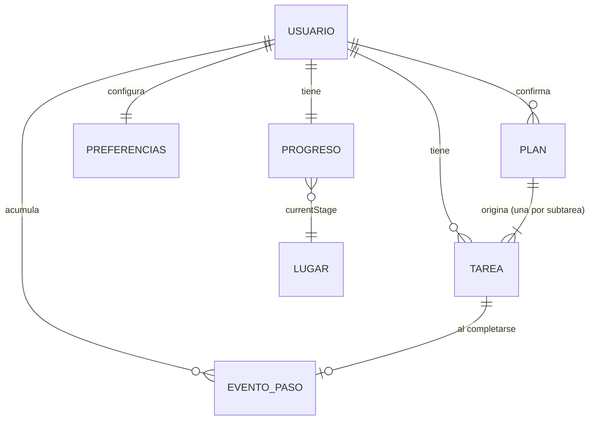

# Modelo de datos

| | |
| --- | --- |
| **Tarea** | Fila 10 del cronograma: diseñar el modelo de datos |
| **Responsable** | Andrea Sosa |
| **Código** | [`taskTypes.ts`](../src/components/tasks/taskTypes.ts), [`planTypes.ts`](../src/services/planning/planTypes.ts), [`worldData.ts`](../src/components/progress/worldData.ts), [`mapping.ts`](../src/services/data/mapping.ts), repositorios en [`src/services/data/`](../src/services/data/) y [`firestore.rules`](../firestore.rules) |

Las siete entidades que pide la fila (Usuario, Tarea, Subtarea, Plan, Progreso, Lugar desbloqueado y Preferencias), con sus campos mínimos y sus relaciones. Describe lo que **está implementado hoy** y marca lo que es **diseño sin implementar**. Dónde vive cada dato y por qué: [`arquitectura.md`](arquitectura.md) §5. Privacidad: [`privacidad.md`](privacidad.md).

## 1. Vista general

```text
Firebase Authentication  ──  uid  ──┐
                                    ▼
users/{uid}                          Usuario + Preferencias + autorizaciones
 ├─ tasks/{taskId}                   Tarea y Subtarea (una fila por actividad ejecutable)
 ├─ completions/{taskId}             Evento de paso (una tarea completada)
 ├─ progress/world                   Progreso (incluye el Lugar actual)
 ├─ plans/{planId}                   Plan confirmado       [diseño; no implementado]
 └─ usage/{AAAA-MM}                  Consumo mensual de IA [diseño; no implementado]

Catálogo fijo en la app (no está en la base de datos):  Lugar (6 escenarios, worldData.ts)
Solo en memoria hasta confirmar:                        Borrador del plan (PlanProposal)
```



Regla común: **todo cuelga de `users/{uid}`** y las reglas de Firestore solo dejan leer y escribir al dueño. No se guarda texto libre, transcripción, audio ni conversación.

## 2. Entidades

### 2.1 Usuario — `users/{uid}`

La cuenta (correo y credenciales) la guarda Firebase Authentication; en Firestore solo hay lo que la app necesita.

| Campo | Tipo | Obligatorio | Descripción |
| --- | --- | --- | --- |
| `uid` | texto | Sí | Clave de la rama; viene de Authentication. Nunca se envía a la IA |
| `consents.dataProcessing.version` | texto | Sí, para usar la app | Versión del aviso aceptado (`PRIVACY_NOTICE_VERSION`) |
| `consents.dataProcessing.acceptedAt` | número (ms) | Sí | Cuándo aceptó |
| `consents.assistant` | igual que arriba | No | **Propuesta** (autorización de la IA); sin implementar |
| `preferences` | mapa | No | Ver 2.7 |
| `availability` | `{days: texto[], minutesPerDay: número}` | No | **Diseño**: hoy la disponibilidad solo vive en la pantalla de Nueva tarea y no se guarda (F05) |

Relaciones: un usuario tiene muchas tareas, eventos de paso y planes; un solo progreso y un solo conjunto de preferencias.

### 2.2 Tarea — `users/{uid}/tasks/{taskId}` (`TaskItem`)

Es la unidad que el usuario ve y completa.

| Campo | Tipo | Obligatorio | Descripción |
| --- | --- | --- | --- |
| `id` | texto | Sí | Id del documento. Si viene de un plan: `plan-<propuesta>-<subtarea>`, estable para no duplicar |
| `title` | texto | Sí | Nombre |
| `detail` | texto | Sí | Línea de contexto (para una subtarea: día y actividad) |
| `duration` | texto | No | Texto legible, p. ej. «1 h 30 min» |
| `notes` | texto | No | Descripción y fecha límite |
| `priority` | número | Sí | Posición en la lista (menor = antes) |
| `difficulty` | `light` \| `medium` \| `high` | Sí | Fácil, media, difícil |
| `dueDate` | `YYYY-MM-DD` | No | Fecha de la tarea; sin ella no cuenta para cerrar la semana |
| `completed` | booleano | Sí | Completada |
| `completedAt` | número (ms) | No | Cuándo se completó |
| `dismissed`, `dismissedAt` | booleano, número | No | «Ya no aplica»: sale de las listas sin dar ni quitar pasos |
| `createdAt` | número (ms) | No | Para saber si existía cuando cerró una semana |
| `tone`, `icon` | texto | Sí | Presentación (color e ícono); no son datos del usuario |

### 2.3 Subtarea — dentro de `PlanActivity` hasta confirmar, luego Tarea

Las subtareas **no son documentos propios**: en el borrador son parte de su actividad, y al confirmar cada una se convierte en una Tarea (`proposalToTasks`). Esto responde a la duda de la arquitectura («si las subtareas son documentos propios o parte de su tarea»).

| Campo de `PlanSubtask` | Tipo | Pasa a la Tarea como |
| --- | --- | --- |
| `id` | texto | Parte del `id` de la tarea |
| `title`, `description` | texto | `title`, `notes` |
| `durationMinutes` | entero 1–1.440 | `duration` |
| `difficulty` | escala | `difficulty` |
| `dependsOn` | ids | Solo se usa en el borrador, para avisos de orden; no se guarda |
| `scheduledDate` | `YYYY-MM-DD` \| null | `detail` (día) |
| `order` | entero | Posición → `priority` |
| `editedFields` | lista | Solo del borrador (qué corrigió el usuario a mano) |

Relación: una actividad del borrador (`PlanActivity`: título, descripción, `deadline`, `priority`, `prioritySource`, `difficulty`) tiene una o más subtareas. La actividad no se guarda como entidad; su título y su fecha límite quedan copiados en el `detail` y las `notes` de sus tareas.

### 2.4 Plan — borrador y plan confirmado

- **Borrador (`PlanProposal`)**: `id`, `summary`, `activities`, `revision`. Vive **solo en el dispositivo** mientras se revisa; al descartarlo desaparece.
- **Plan confirmado — `users/{uid}/plans/{planId}`** (**diseño, no implementado**; hoy solo se guardan las tareas que genera):

| Campo | Tipo | Descripción |
| --- | --- | --- |
| `id` | texto | Id de la propuesta |
| `summary` | texto | La frase «sugerencia de Pandoro» (generada por la IA, sin el texto del usuario) |
| `taskIds` | texto[] | Tareas que originó |
| `confirmedAt` | número (ms) | Cuándo se aprobó |

  Decisión pendiente: guardar este documento o retirarlo de la arquitectura. Mientras no exista, el id estable de las tareas evita duplicados.

### 2.5 Progreso — `users/{uid}/progress/world` (`ProgressWorldSnapshot`)

Un solo documento.

| Campo | Tipo | Descripción |
| --- | --- | --- |
| `currentStage` | entero 1–6 | Lugar actual (referencia al catálogo). Solo sube |
| `completedTasks` | entero ≥ 0 | Pasos acumulados (una tarea completada = un paso) |
| `stageStartSteps` | entero ≥ 0 | Pasos cuando se ganó el lugar actual; de ahí camina Pandoro |
| `unlockedWeeks` | `YYYY-MM-DD`[] | Lunes de las semanas que ya dieron un lugar; sin repetidos |
| `lastAcknowledgedWeekKey` | `YYYY-MM-DD` \| null | Última semana cuyo cierre ya vio el usuario |
| `streak` | entero | **Obsoleto**: se conserva por compatibilidad; la app ya no lo muestra |

Evento de paso — `users/{uid}/completions/{taskId}`: `{ completedAt: número }`. Un documento por tarea completada; su id es el de la tarea, así que completar dos veces no suma dos. La semana de un paso se deduce de `completedAt`, no de la fecha de entrega.

Cómo se cuenta el progreso: [`progreso.md`](progreso.md).

### 2.6 Lugar desbloqueado

No es un documento: el catálogo de seis escenarios está en código (`PROGRESS_WORLD_STAGES`) y el lugar desbloqueado se deduce de `currentStage`: los lugares con `id` menor son «completados», el igual es el «actual» y el resto están «bloqueados». Cada semana ganada se registra en `unlockedWeeks`.

| Campo del catálogo | Tipo |
| --- | --- |
| `id` | 1–6 |
| `title`, `description` | texto |
| `landmark` | `pond`, `origamiForest`, `venusHouse`, `ghostRoses`, `starValley`, `panden` |
| `x`, `y` | posición en el mapa |

### 2.7 Preferencias — `users/{uid}.preferences`

Mapa de booleanos; los valores que no sean verdadero/falso se ignoran al leer.

| Clave | Por defecto | Descripción |
| --- | --- | --- |
| `darkMode` | falso | Modo oscuro |
| `reduceMotion` | verdadero | Menos animación |
| `taskReminders` | verdadero | Recordatorios de tareas (F10) |
| `weeklySummary` | verdadero | Resumen semanal |
| `pandoroTips` | verdadero | Mensajes de Pandoro |
| `sounds` | falso | Sonidos |
| `haptics` | verdadero | Vibración |
| `usageAnalytics` | falso | Registro de uso (opcional; por defecto apagado) |

### 2.8 Consumo de IA — `users/{uid}/usage/{AAAA-MM}` (diseño, no implementado)

`{ requests: número }` por mes, para mostrar la cuota antes de confirmar una operación. Límite conocido: sin servidor propio el contador lo lleva la app ([`arquitectura.md`](arquitectura.md) §7).

## 3. Reglas de integridad

- Una tarea completada tiene exactamente un evento de paso; desmarcarla solo es posible en la semana abierta y borra ese evento.
- Los pasos, lugares y semanas ganadas **no se revierten** (la gamificación no castiga).
- Un documento dañado o de una versión anterior nunca rompe la lista: `taskFromDoc` corrige o ignora, y `progressFromDoc` usa valores por defecto.
- Confirmar un plan escribe todas sus tareas en un lote: se guardan todas o ninguna.
- Eliminar la cuenta borra toda la rama `users/{uid}` (flujo completo por implementar; ver [`privacidad.md`](privacidad.md) §5).
- Acceso: `request.auth.uid == uid` sobre `users/{uid}/**`; todo lo demás queda denegado.

## 4. Por confirmar

| Tema | Quién |
| --- | --- |
| Guardar `plans` y `usage` o retirarlos de la arquitectura | Andrea y Carlos |
| Guardar la disponibilidad (F05) en `users/{uid}` | Andrea y Santiago |
| Dónde irá la constancia del consentimiento tras eliminar la cuenta | Equipo ([`privacidad.md`](privacidad.md) §5) |
| Retirar `streak` del documento de progreso | Carlos |
